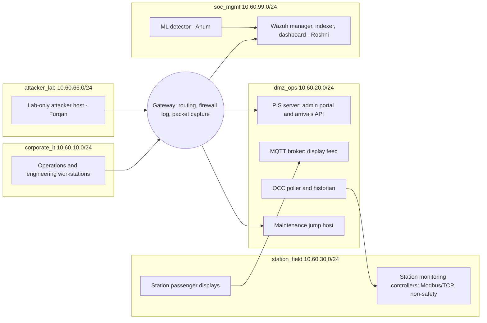
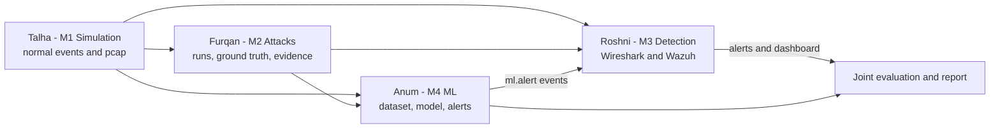

# PLAN - SOC for Railway & Metro Systems (4 modules, 4 people)

> **Canonical plan** - v0.4 - 2026-11-05 - team: **Talha, Furqan, Roshni, Anum**
> Repo: `rail-metro-soc` - branches `main` (release) and `develop` (integration) - change this file only through a PR (`docs/docs/<slug>` branch).
> Source brief: the course document *Project Details* (kept in the private workspace, not in this repo). Assignment confirmed by the team on 2026-11-05: **Talha = simulation (M1), Furqan = attack generation (M2), Roshni = attack detection (M3), Anum = ML (M4)**; Talha is also repo admin and release manager.
>
> **Timeline changed 2026-11-05: the team has one day (2026-11-06), not six weeks.** This plan stays the full reference (every requirement, every hard constraint, the complete task backlog) so nothing required gets missed, but section 8 is now a one-day timeline and the actual step-by-step for tomorrow is the short, per-person **[plan/DAY1_PLAN.md](DAY1_PLAN.md)** - read that one first. Build a small, honest system: every requirement in section 2 met, nothing bigger pretended. See HC-23.

## Contents

1. [TL;DR](#1-tldr)
2. [Hard constraints](#2-hard-constraints-non-negotiable)
3. [Team - who does what](#3-team---who-does-what)
4. [Architecture overview](#4-architecture-overview)
5. [Shared contracts](#5-shared-contracts)
6. [Repository and workspace structure](#6-repository-and-workspace-structure)
7. [Git workflow, tests gate and CI](#7-git-workflow-tests-gate-and-ci)
8. [Roadmap and milestones](#8-roadmap-and-milestones)
9. [Module 1 - Simulation & Architecture (Talha)](#9-module-1---simulation--architecture-talha)
10. [Module 2 - Attack Generation (Furqan)](#10-module-2---attack-generation-furqan)
11. [Module 3 - Detection: Wireshark + SIEM (Roshni)](#11-module-3---detection-wireshark--siem-roshni)
12. [Module 4 - ML Threat Detection (Anum)](#12-module-4---ml-threat-detection-anum)
13. [Cross-module tasks](#13-cross-module-tasks)
14. [Deliverables traceability](#14-deliverables-traceability)
15. [Rubric coverage](#15-rubric-coverage)
16. [Technical report outline](#16-technical-report-outline)
17. [Demo and viva preparation](#17-demo-and-viva-preparation)
18. [Risks and mitigations](#18-risks-and-mitigations)
19. [Definition of done](#19-definition-of-done)
20. [Glossary and references](#20-glossary-and-references)

---

## 1. TL;DR

| Module | Owner | Reviewer | Rubric | Goal | Folder |
|---|---|---|---|---|---|
| **M1 Simulation & Architecture** | **Talha** | Roshni | criterion 1 (40) | A reproducible railway/metro IT + station-telemetry lab that produces normal traffic and logs; architecture diagram; protocol-stack discussion | `src/simulation/` |
| **M2 Attack Generation** | **Furqan** | Talha | criterion 2 (30) | Three controlled, documented, labelled attack scenarios with evidence and normal-activity baselines | `src/attacks/` |
| **M3 Detection (Wireshark + SIEM)** | **Roshni** | Anum | criterion 3 (30) | Wireshark analysis, Wazuh rules/queries/dashboard, detection evaluation | `src/detection/` |
| **M4 ML Threat Detection** | **Anum** | Furqan | extension that feeds criterion 3 | An ML detector that finds the three scenarios (and unknown anomalies) and shows its alerts in the SIEM dashboard | `src/ml/` |

**How we work:** every change starts on its own branch -> pull request into `develop` -> CI must be green and the reviewer must approve -> merge. `develop` goes to `main` only through a release PR at a milestone (section 7).

**One day, not six weeks (2026-11-06):** this is the full plan - everything a complete submission needs, so no requirement is missed - but today's actual work is scoped down to a small, honest MVP. Follow **[plan/DAY1_PLAN.md](DAY1_PLAN.md)** for the concrete, timeboxed, per-person steps; treat the task tables in sections 9-12 as the complete backlog, not as today's to-do list.

---

## 2. Hard constraints (non-negotiable)

Every row is a rule the team cannot trade away. *Enforced by* says where the rule is checked (code, CI or review). `tests/test_contracts.py` fails if a row is removed.

### 2.1 From the course brief

| ID | Constraint | Source | Enforced by |
|---|---|---|---|
| HC-01 | Topic is **SOC for Railway and Metro Systems**: simulate railway IT, passenger-information services and *non-operational* signaling test logs; detect unauthorized administrative access, anomalous communications and service disruptions. | Brief (idea list) | This plan; module READMEs; review |
| HC-02 | **Never connect experiments to operational signaling systems** or to any real railway, metro or utility network. | Brief | HC-18 isolation; `LabScope`; Rules of Engagement |
| HC-03 | All testing uses **simulated devices, synthetic data or authorised laboratory traffic** only. | Brief | `src/attacks/RULES_OF_ENGAGEMENT.md`; `railsoc_attacks.safety`; synthetic generator |
| HC-04 | **Exactly three** controlled attack scenarios. For each: procedure, expected indicators, generated events, supporting evidence - plus normal activity for comparison. | Brief (Task 2) | `test_exactly_the_three_required_scenarios_exist`; `SCENARIO_TEMPLATE.md`; M2-07 baselines |
| HC-05 | Detection uses **Wireshark** (packet analysis) **and a SIEM - Wazuh or Splunk** - with search queries executed and a dashboard that summarises the findings. | Brief (Task 3) | Module 3 tasks; section 14 |
| HC-06 | The simulation generates **normal communication traffic, authentication events and logs** for the environment, communication infrastructure and management systems, and correlates logs with the underlying protocol. | Brief (Task 1, Student 1) | M1-08, M1-11 |
| HC-07 | The **seven deliverables** exist: architecture diagram; protocol-stack discussion; working or reproducible simulation; three attacks with evidence; Wireshark packet-analysis evidence; SIEM queries, results and dashboard; technical report (implementation, results, screenshots, mitigation recommendations). | Brief | Traceability matrix (section 14); release gates |
| HC-08 | Marking: **40** (architecture, protocol understanding, simulation) + **30** (attack generation) + **30** (Wireshark + SIEM detection) = 100. | Brief | Rubric coverage (section 15) |
| HC-09 | **Everyone** takes part in integration, testing and the final evaluation, and **each person understands the whole project**, not only their module. | Brief (extended to four people) | X-05 knowledge transfer; review ring; Q&A bank |
| HC-10 | Each project idea may be chosen by **only one group**: register the idea through the link in the brief. (The brief text mentions "the following link" but no URL is in the document - ask the instructor.) | Brief | X-01 |
| HC-11 | The brief assumes groups of **3**; this team has **4** because of the ML module - get the instructor's confirmation in writing. | Brief vs team | X-01 |

### 2.2 From the team

| ID | Constraint | Source | Enforced by |
|---|---|---|---|
| HC-12 | **Four modules, four people.** Module 4 is a machine-learning model that detects threats and attacks (the three scenarios and beyond) and **works with all three other modules**: trained on Talha's data, labelled by Furqan's ground truth, alerts shown in Roshni's SIEM dashboard. | Team | M4 tasks; `ml.alert` contract; `railsoc_detection.evaluate` scores rules and ML alike |
| HC-13 | GitHub repository `rail-metro-soc` with exactly two long-lived branches, **`main` and `develop`**; starter code for all members is pushed first; final structure as in section 6. | Team | `docs/github_setup.md`; `test_repo_root_stays_tidy` |
| HC-14 | **Every individual change goes into its own branch first**, is merged into `develop` **only with tests and only if the tests pass**; `main` only receives `develop` through a release PR. | Team | Branch protection + required check `ci-gate`; `policy_check.py branch` |
| HC-15 | **Claude (or any AI assistant) is not a contributor**: no co-author or "generated with" lines, never added as collaborator. The AI never pushes and never opens PRs; it prints PR links and a human opens them. | Team | CI `policy_check.py attribution`; `scripts/pr_link.py` only prints links |
| HC-16 | A **private `context/` folder** in Talha's workspace (outside the repo, never pushed) is updated after every major code change so nothing is lost if a session is deleted. | Team | `.gitignore` safety net; Talha's habit |
| HC-17 | This plan lists **every hard constraint** (this section) and **names who does each part**. | Team | `tests/test_contracts.py` (IDs and names) |

### 2.3 Engineering guardrails (checked by code)

| ID | Constraint | Source | Enforced by |
|---|---|---|---|
| HC-18 | **Isolated lab.** Every lab network is `internal: true`, every address is inside `10.60.0.0/16`, ports are published on `127.0.0.1` only; attack tooling refuses any other target (hostnames included). | Guardrail | `src/common/railsoc_common/lab.py`; `railsoc_attacks.safety`; contract tests |
| HC-19 | **Contracts.** Every event validates against `event.schema.json`; ground-truth labels never appear inside events; all timestamps are UTC. | Guardrail | `railsoc_common.events.validate_event`; tests |
| HC-20 | **No secrets, no files over 10 MB, no pcaps/datasets/models in git.** | Guardrail | `.gitignore`; CI `policy_check.py files` |
| HC-21 | **Reproducible.** From a clean clone the documented commands bring up the lab and the tests; seeds and versions are recorded. | Guardrail | X-06 clean-machine test; seeded generators |
| HC-22 | Safety-related railway functions (points, signals, interlocking, train protection) are **neither simulated nor attacked**; scenario C is time-boxed, rate-capped and has a kill switch. | Guardrail | Rules of Engagement; `LabScope` caps; `test_station_controllers_are_monitoring_class_only` |
| HC-23 | **Real protocols, nothing assumed or makeshifted.** Every simulated exchange is genuine wire traffic from a real client and a real server of that protocol (HTTP, MQTT, Modbus/TCP, SSH) - never a JSON line written to pretend an exchange happened. The matching schema log is written by the component that actually handled the real exchange. Keep each protocol's implementation small and plain; one working minimal version beats several elaborate, unfinished ones. | Team (added for the one-day build) | Manual review in every PR (a pcap-based automated check is a later stretch goal, not assumed to exist); `plan/DAY1_PLAN.md` |

---

## 3. Team - who does what

### 3.1 Roster

| Person | Role | Module and folder | Branch prefix | Reviewer of their PRs | GitHub username |
|---|---|---|---|---|---|
| **Talha** | Simulation Lead; owner of the event schema; report integrator; **repo admin and release manager**; keeper of the private context folder | M1 - `src/simulation/` | `feature/sim/` | Roshni | *(fill in)* |
| **Furqan** | Attack Lead; owner of the ground-truth format; runs the clean-machine test | M2 - `src/attacks/` | `feature/attacks/` | Talha | *(fill in)* |
| **Roshni** | Detection Lead; owner of the SIEM and Wireshark evidence | M3 - `src/detection/` | `feature/detection/` | Anum | *(fill in)* |
| **Anum** | ML Lead | M4 - `src/ml/` | `feature/ml/` | Furqan | *(fill in)* |

**Review ring:** Talha <- Roshni - Furqan <- Talha - Roshni <- Anum - Anum <- Furqan. The reviewer is also the backup who can take over the module. Changes in `src/common/` or `docs/contracts/` (a **contract change**) need approval from **two** members, including at least one consumer of the contract.

### 3.2 Handoffs - who gives what to whom

| From | To | What | When |
|---|---|---|---|
| Talha | Furqan | Lab with PIS, jump host, station telemetry, attacker zone; `reset_lab`; run-id hook | end of Phase 1 |
| Talha | Roshni | Log-source inventory, logs/agents ready, gateway pcaps, protocol docs | Phases 1-2 |
| Talha | Anum | Normal-traffic generator (seeds, profiles), >= 12 simulated hours of normal data incl. benign look-alikes, asset inventory | Phase 2 |
| Furqan | Talha | Requirements for attacker placement, reset and hard-negative look-alike traffic | Phase 1 |
| Furqan | Roshni | Documented indicators, evidence packs, baseline windows per scenario | Phases 2-3 |
| Furqan | Anum | `lab/ground_truth/attack_runs.csv` and campaign runs (>= 10 varied runs per scenario) | Phase 3 |
| Roshni | Talha | Sign-off that every log source arrives in the SIEM | Phase 2 |
| Roshni | Furqan | Per-scenario feedback: which indicators are detectable, which are missing | Phases 3-4 |
| Roshni | Anum | SIEM path for `ml.alert`, rule ids 100400-100499, dashboard ML panel, `alerts.json` exports | Phases 4-5 |
| Anum | Talha | Data needs (volume, look-alikes, field requirements) written down early | Phase 1 |
| Anum | Furqan | Label-validation feedback; requests for more or more varied runs | Phases 3-4 |
| Anum | Roshni | Model output, metrics and `ml.alert` events for the dashboard panel | Phases 4-5 |

### 3.3 Your part - one card per person

**Talha - Module 1 (Simulation Lead and repo admin)**
- Deliver: architecture diagram, protocol-stack discussion, reproducible simulation, normal traffic and logs, log-to-protocol correlation, simulation documentation (tasks M1-01 ... M1-13).
- First PR: `feature/sim/M1-01-assets-and-architecture` (reviewer: Roshni).
- Also: owns the event schema and `assets.csv`; integrates the technical report (X-07).
- Repo admin and release manager: creates the GitHub repo, `main` + `develop`, branch protection and collaborators, opens the release PRs, keeps the private `context/` folder (X-01, X-02).
- Needs: Furqan's attacker/reset requirements; Roshni's log-source list; Anum's data requirements.

**Furqan - Module 2 (Attack Lead)**
- Deliver: rules of engagement, three scenarios with procedure/indicators/events/evidence, baselines, ground-truth labels, campaign runs, mitigation recommendations (tasks M2-01 ... M2-12).
- First PR: `feature/attacks/M2-01-rules-of-engagement` (reviewer: Talha). All four sign off the rules.
- Also: owns the ground-truth format; runs the clean-machine test (X-06).
- Needs: Talha's lab and reset script; Roshni's detectability feedback; Anum's label checks.

**Roshni - Module 3 (Detection Lead)**
- Deliver: Wazuh deployment and ingestion, decoders and rules, Wireshark evidence, SIEM queries, dashboard, alerting/playbooks, detection evaluation (tasks M3-01 ... M3-12).
- First PR: `feature/detection/M3-01-wazuh-deploy` (reviewer: Anum).
- Also: owns the log-source sign-off and the SIEM side of the ML integration (M4-11).
- Needs: Talha's log sources and pcaps; Furqan's indicators and baselines; Anum's `ml.alert` events.

**Anum - Module 4 (ML Lead)**
- Deliver: problem framing, dataset, features, models, evaluation, inference service, SIEM integration with Roshni, model and dataset cards (tasks M4-01 ... M4-13).
- First PR: `feature/ml/M4-01-problem-framing` (reviewer: Furqan).
- Needs: Talha's normal data; Furqan's ground truth and campaigns; Roshni's SIEM ingestion path.

---

## 4. Architecture overview

All assets are synthetic and live in isolated Docker networks. The "station controllers" are **monitoring-class, non-safety** devices (temperature, power feeder, lift status); the signaling side is only a generator of **non-operational test logs**.



How the four modules feed each other:



Protocols in scope (details in `docs/protocols/`, written by Talha): Ethernet/VLAN, IPv4, TCP/UDP, HTTP(S) (PIS portal and API), MQTT (display feed), Modbus/TCP (monitoring telemetry), SSH (maintenance), Syslog, NTP, DNS. Described but **not** simulated: GSM-R/FRMCS, CBTC radio, safety signaling protocols (EN 50159 is used for the threat vocabulary only).

---

## 5. Shared contracts

Contracts are what lets four people work in parallel. They live in `src/common/` (code) and `docs/contracts/` (text), and are frozen as **v0.1** at the end of Phase 0 (task X-03).

| Contract | Owner | Consumers | Where |
|---|---|---|---|
| Event schema (JSON Lines, UTC, no labels) | **Talha** | Roshni (SIEM), Anum (ML), Furqan (evidence) | `src/common/railsoc_common/schemas/event.schema.json`, `docs/contracts/event_schema.md` |
| Ground-truth runs and labelling rule | **Furqan** | Roshni (evaluation), Anum (dataset) | `src/common/railsoc_common/groundtruth.py`, `docs/contracts/ground_truth.md`, `lab/ground_truth/attack_runs.csv` |
| Asset inventory and IP plan (`10.60.0.0/16`, five zones) | **Talha** | everyone | `src/simulation/config/assets.csv`, `src/common/railsoc_common/lab.py` |
| Lab scope, caps and kill switch | **Furqan** | everyone who runs attacks | `src/attacks/config/lab_scope.toml`, `src/attacks/RULES_OF_ENGAGEMENT.md` |
| Run ids `RUN-<A\|B\|C\|BASELINE>-<UTC>-<nn>` | **Furqan** | everyone | `src/common/railsoc_common/ids.py` |
| Wazuh custom rule id ranges: 100000-100099 common, 100100-100199 A, 100200-100299 B, 100300-100399 C, 100400-100499 ML | **Roshni** | Anum (ML rules) | `src/detection/siem/rules/`, lint in CI |

**Contract change process:** open a PR that touches the code, the doc **and** the tests; the owner plus one consumer approve; announce it in the team chat; bump `CONTRACT_VERSION` if fields change.

---

## 6. Repository and workspace structure

The Desktop folder `soc/` is a **workspace**, not a git repository. Only `soc/rail-metro-soc/` is the repository; run all git commands there.

```
soc/                                  workspace on Talha's Desktop (NOT a git repo)
|-- brief/                            course brief (docx) - local only
|-- context/                          private session memory - never pushed (HC-16)
|-- CLAUDE.md, README.md, .gitignore  workspace notes; .gitignore ignores everything here
`-- rail-metro-soc/                   THE GIT REPO  (branches: main + develop)
    |-- plan/
    |   `-- PLAN.md                   this plan (hard constraints, names, tasks)
    |-- src/                          all source code, one folder per module
    |   |-- common/                   shared contracts: events, ground truth, ids, lab scope   (all four)
    |   |-- simulation/               Module 1 - Talha
    |   |-- attacks/                  Module 2 - Furqan
    |   |-- detection/                Module 3 - Roshni
    |   `-- ml/                       Module 4 - Anum
    |-- docs/
    |   |-- architecture/             diagram + architecture text (Talha)
    |   |-- protocols/                protocol-stack discussion, register map, log-to-packet mapping (Talha)
    |   |-- contracts/                event schema (Talha), ground truth (Furqan)
    |   |-- report/                   technical report, mitigations, evaluation (all; Talha integrates)
    |   `-- github_setup.md           one-time GitHub setup (Talha)
    |-- lab/
    |   |-- evidence/                 per-run evidence: manifest, log slices, screenshots (Furqan, Roshni); big pcaps stay outside git
    |   |-- ground_truth/             attack_runs.csv (Furqan)
    |   `-- data/                     generated datasets - NOT in git
    |-- tests/                        repo-level tests (hard constraints, policy, PR links)
    |-- scripts/                      pr_link.py, policy_check.py, check_all.py
    |-- .github/                      CI workflow, PR template, CODEOWNERS
    `-- README.md  CONTRIBUTING.md  pyproject.toml  .gitignore  .gitattributes  .editorconfig  .dockerignore
```

Inside each module folder:

```
src/<module>/
|-- railsoc_<name>/     the Python package (code)
|-- tests/              unit tests - run in CI
|-- config/ or configs/ settings
|-- docs/ or reports/   module documentation
`-- README.md           owner, reviewer, handoffs, rules, quick start
```

**What goes into git:** source, tests, docs, configs, small samples (<= 5 MB each in `lab/evidence/samples/`), ground-truth CSV, Wireshark profile, dashboard exports.
**What never goes into git (HC-20):** `.env`, keys, pcaps, datasets, models, archives, caches, virtual environments, personal files. The root `.gitignore` covers all of it; `test_repo_root_stays_tidy` keeps the root from filling up again.

---

## 7. Git workflow, tests gate and CI

### 7.1 Branches

| Branch | Purpose | Who writes to it | Protection |
|---|---|---|---|
| `main` | Stable releases, tagged `v0.1` ... `v1.0` | Only a release PR from `develop` | PR required, 2 approvals, `ci-gate` required, no direct pushes, no force-push |
| `develop` | Integration - always green | Only PRs from feature branches | PR required, 1 approval from the reviewer, `ci-gate` required, branch up to date, conversations resolved, no direct pushes |
| `feature/<module>/<TASK-ID>-<slug>` | One task | Its author | none; deleted after merge |

Allowed prefixes: `feature`, `fix`, `docs`, `chore`, `test`. Allowed modules: `common`, `sim`, `attacks`, `detection`, `ml`, `docs`, `ci`, `repo`.
Examples: `feature/sim/M1-04-pis-service`, `feature/attacks/M2-04-admin-access`, `feature/detection/M3-04-rules`, `feature/ml/M4-07-supervised-models`, `docs/docs/update-plan`.

### 7.2 The flow for every change

1. `git switch develop && git pull`, then `git switch -c feature/<module>/<TASK-ID>-<slug>`.
2. Write the code **and its tests** in the same branch (tests live in the module's `tests/` folder).
3. Run `python scripts/check_all.py` (lint + tests + compose validation = what CI runs). Fix until green.
4. `git push -u origin <branch>`, then print the PR link with `python scripts/pr_link.py` and open it in the browser. **An AI assistant only prints the link; a person opens the PR (HC-15).**
5. The reviewer from the ring reviews; CI must be green; squash-merge into `develop`; delete the branch.
6. At a milestone, Talha opens the release PR `develop` -> `main` (`python scripts/pr_link.py --release`); two approvals; merge commit; tag.

Commit messages use Conventional Commits with the module as scope: `feat(sim): M1-04 PIS login events`, `fix(ml): leak in split`, `docs(plan): add handoffs`. **No co-author or "generated with" lines** (CI rejects them).

### 7.3 What CI checks (`.github/workflows/ci.yml`)

| Job | Runs on | Checks |
|---|---|---|
| `policy` | pull requests | branch name and PR direction; no AI attribution in commits/PR text; no secrets or files over 10 MB |
| `test (common / simulation / attacks / detection / ml / repo)` | every PR and push | `ruff` lint and `pytest` for that module (the `repo` job runs the hard-constraint, policy and PR-link tests) |
| `compose config` | every PR and push | `docker compose config` validates the lab file |
| `ci-gate` | every PR and push | one required check that is green only when all jobs above are green |

CI never starts the lab and never sends traffic. Docker-based smoke tests (marker `docker`) run locally with `pytest -m docker`.

### 7.4 One-time GitHub setup (Talha) - details in `docs/github_setup.md`

```bash
git init -b main
git add .
git status
git commit -m "chore: initial scaffold (plan, contracts, module starters, CI)"
git remote add origin https://github.com/<OWNER>/rail-metro-soc.git
git push -u origin main
git switch -c develop
git push -u origin develop
```

Then: set `develop` as the default branch, protect `main` and `develop` as in 7.1, add the other three as collaborators, and open the first PR so `ci-gate` appears in the list of required checks. On a free personal GitHub plan, protection rules are only available for public repositories (private repositories need GitHub Pro; students can get it through the GitHub Student Developer Pack) - check *Settings -> Branches*; without protection the team enforces the same rules by discipline and the CI check still shows red/green on every PR.

### 7.5 PR links

```bash
python scripts/pr_link.py            # current branch -> develop
python scripts/pr_link.py --all      # every local feature branch that is ahead of develop
python scripts/pr_link.py --release  # develop -> main
```

The link has the form `https://github.com/<OWNER>/rail-metro-soc/compare/develop...<branch>?expand=1&title=...`; the PR template fills the description.

---

## 8. Roadmap and milestones

**Changed 2026-11-05: one day, not six weeks.** The phased, multi-week roadmap below is kept as the *full-ambition reference* (what a longer project would do, and in what order) - it is **not** today's to-do list. Today's actual steps are the short **[plan/DAY1_PLAN.md](DAY1_PLAN.md)**, which compresses Phase 0 + the start of Phases 1-3 into four checkpoints run in parallel by all four people, aimed squarely at the seven deliverables (HC-07) and nothing more. If a future session adds more days, resume at Phase 2 below using whatever Day 1 did not finish.

Assumption for the table below: about six weeks from the day the repo is pushed, *if* the team had six weeks. Each gate is a tagged release.

| Phase | Window | Talha | Furqan | Roshni | Anum | Gate |
|---|---|---|---|---|---|---|
| **0 Kickoff and contracts** | days 1-3 | Create the repo, `main` + `develop`, protection, first push (X-02); register the idea and confirm group size (X-01); review `assets.csv` and the event schema | Sign off the Rules of Engagement (M2-01); review the ground-truth format | Choose the Wazuh tag; check RAM/WSL2 (M3-01 prep) | Problem framing (M4-01); review the event schema and ground-truth format | Starter on `main`, CI green, contracts frozen -> `v0.1` |
| **1 Foundations** | week 1 | M1-01 architecture, M1-03 zones + gateway, M1-04 PIS | M2-02 threat model, M2-03 attacker host, scenario doc drafts; requirements to Talha | M3-01 Wazuh up, M3-05 Wireshark workflow on sample pcaps | M4-02 environment, M4-03 pipeline dry run; data needs to Talha | Lab up, normal events flowing, Wazuh dashboard up -> `v0.2` |
| **2 Baseline and ingestion** | week 2 | M1-05 telemetry, M1-06 jump host, M1-07 signaling logs, M1-08 profiles, M1-09 capture, M1-10 with Roshni | M2-04/05/06 prototypes, M2-07 baselines start, M2-08 recorder | M3-02 ingestion, M3-03 decoders, first baseline dashboard | M4-04 ingestion, M4-05 features on lab data | Every log source visible in Wazuh; >= 12 h of normal data; baselines recorded |
| **3 Attack campaigns and first detections** | week 3 | M1-11 log-to-protocol document, M1-12 reset and run hooks; look-alike traffic with Furqan | M2-04..06 runs, M2-09 ground truth with Anum, M2-10 campaign | M3-04 rules, M3-06 Wireshark evidence, M3-07 queries | M4-06/07 baselines and supervised models on `dataset_v1` | Three scenarios run end to end with labelled evidence; each detected by a rule; `dataset_v1` built -> `v0.4` |
| **4 Tuning, dashboards, ML v1** | week 4 | M1-13 reproducibility pack; reviews | M2-11 scenario docs, M2-12 mitigations with Roshni; more varied runs | M3-08 dashboard with Anum, M3-09 playbooks, M3-11 tuning | M4-08 anomaly models, M4-09 evaluation, M4-10 inference | Dashboard works; ML v1 metrics on held-out runs |
| **5 Integration and evaluation** | week 5 | Support fixes; report architecture/protocol chapters | X-06 clean-machine test; final scenario docs | M3-10 evaluation with Anum | M4-11 SIEM integration with Roshni; M4-12 cards | Release candidate `v0.9`; evaluation tables final |
| **6 Report and demo** | week 6 | X-07 report integration | Chapter: attacks and mitigations | Chapter: detection and dashboard | Chapter: ML and evaluation | Report done, two rehearsals (X-08) -> `v1.0` |

### 8.1 The one day (2026-11-06)

Four checkpoints, worked in parallel; cross into the next block only once its checkpoint is true. Full detail, commands and library choices: **[plan/DAY1_PLAN.md](DAY1_PLAN.md)**.

| Block | Talha (M1) | Furqan (M2) | Roshni (M3) | Anum (M4) | Checkpoint |
|---|---|---|---|---|---|
| Morning (independent) | Build the real-protocol services (HTTP, Modbus/TCP, SSH; MQTT if time) and the traffic driver | Write scenarios A and C against a throwaway local copy of the HTTP service | Stand up Wazuh single-node; prepare Wireshark filters | Re-run the existing ML CLI on a tiny hand-made sample to confirm it still passes | - |
| Checkpoint 1 | **Lab is up: real pcap + schema-valid logs exist** | | | | gate |
| Early afternoon | Support; write the architecture note | Run all three scenarios for real; append ground truth | Capture Wireshark evidence from the real pcap; write/validate rules | Build `dataset_v1` from the real normal + attack data, train | - |
| Checkpoint 2 | | | **Each scenario fires a rule; ML produces `ml.alert` for at least one** | | gate |
| Late afternoon | Protocol-stack note; help wherever stuck | Finish scenario docs | Build one simple dashboard (overview + 3 scenarios + ML panel) | Evaluate against held-out runs | - |
| End of day | Everyone opens their PR into `develop`; 10-minute sync; note genuinely unfinished items honestly (HC-23) - do not claim something works that was not actually run | | | | - |

---

## 9. Module 1 - Simulation & Architecture (Talha)

**Owner:** Talha - **Reviewer:** Roshni - **Rubric:** criterion 1 (40 marks) - **Folder:** `src/simulation/` - **Starter code:** asset inventory, traffic profiles, deterministic normal-traffic generator, PIS stub, compose file with five isolated zones, tests.
**Gives:** Furqan the lab and reset script; Roshni log sources and pcaps; Anum normal data and the asset inventory.
**Today (2026-11-06):** the task table below is the full backlog, not today's steps - follow [plan/DAY1_PLAN.md](DAY1_PLAN.md) section "Talha" instead, which covers M1-01, M1-03/04/05/06 and M1-09 with **real** HTTP, Modbus/TCP and SSH traffic (HC-23); the rest stays open for later.

| ID | Who | Task | Output | Done when | Needs | Size |
|---|---|---|---|---|---|---|
| M1-01 | Talha | Architecture and zoning: zones, assets, flows, trust boundaries; map to IEC 62443 zones/conduits | `docs/architecture/architecture.md`, diagram source + PNG/SVG, `src/simulation/config/assets.csv` | All four reviewed; `assets.csv` stays the single source of truth for ids/IPs/zones (contract test green) | - | M |
| M1-02 | Talha | Protocol-stack discussion: L1-L7 per flow, ports, security properties, railway context (EN 50159 threat categories; GSM-R/FRMCS and CBTC described only) | `docs/protocols/protocol_stack.md` | Covers every flow of M1-01; each protocol has "normal behaviour" and "what an anomaly looks like" | M1-01 | M |
| M1-03 | Talha | Compose segmentation and gateway: routing between zones, firewall log lines, isolation proof | `src/simulation/docker-compose.yml`, `src/simulation/services/gateway/` | `docker compose up` works on a clean machine; no internet egress from lab networks; contract tests green | M1-01 | L |
| M1-04 | Talha | PIS service: admin portal/API with login, config-change and user-create audit events; MQTT feed to displays | `src/simulation/railsoc_sim/pis_stub.py`, `services/mqtt/` | Schema events for login/request/config_change; unit tests; healthcheck | M1-03 | M |
| M1-05 | Talha | Station telemetry simulators (Modbus/TCP, non-safety registers), OCC poller, historian | `src/simulation/services/station_sim/`, `docs/protocols/register_map.md` | Stable polling; documented registers; `scada.poll` events | M1-03 | L |
| M1-06 | Talha | Jump host and auth logs (SSH, sudo), synthetic staff accounts and shift patterns | `src/simulation/services/jumphost/` | `auth.ssh` events visible | M1-03 | M |
| M1-07 | Talha | Synthetic signaling-test log generator (non-operational, fictional message names, documented format) | `src/simulation/services/signaling_logs/`, `docs/protocols/signaling_test_log_format.md` | Seeded generator; no link to any real or operational signaling system (HC-02) | M1-01 | M |
| M1-08 | Talha | Normal-traffic engine: peak/off-peak/night, speed factor, seeds, benign look-alikes (typo logins, authorised maintenance writes, rush-hour bursts) | `src/simulation/railsoc_sim/generator.py`, `config/traffic_profiles.toml` | N simulated hours reproducible by seed; volume report; look-alikes present | M1-04..07 | L |
| M1-09 | Talha | Packet capture at the gateway: rotating pcaps with UTC names, window export script; optional Suricata/Zeek | `src/simulation/services/gateway/capture.sh` | pcap shows inter-zone traffic for every protocol and opens in Wireshark | M1-03 | M |
| M1-10 | Talha + Roshni | Log shipping to the SIEM and the log-source inventory | `docs/contracts/log_sources.md` | Every source in the inventory is visible in the SIEM | M1-04..06, M3-02 | M |
| M1-11 | Talha | Log-to-protocol correlation: event -> packets -> fields -> timestamps | `docs/protocols/log_to_packet_correlation.md` | Per event type: example log line, Wireshark filter, pcap excerpt | M1-09, M1-10 | M |
| M1-12 | Talha (Furqan and Anum use it) | Run hooks: time sync, `reset_lab`, run-id injection, volume targets | `src/simulation/scripts/reset_lab.*` | Clean state in under 2 minutes; clock drift under 1 s | M1-03 | M |
| M1-13 | Talha (Furqan runs it) | Reproducibility pack: README, prerequisites (RAM/WSL2), troubleshooting; clean-machine run | `src/simulation/README.md` | Furqan brings the lab up from a fresh clone using only the README | all | M |

---

## 10. Module 2 - Attack Generation (Furqan)

**Owner:** Furqan - **Reviewer:** Talha - **Rubric:** criterion 2 (30 marks) - **Folder:** `src/attacks/` - **Starter code:** safety harness (`LabScope`, kill switch, caps), scenario framework, recorder (manifest + ground-truth row), campaign runner, three scenario stubs and docs, Rules of Engagement.
**Gives:** Talha attacker/reset requirements; Roshni indicators, evidence and baselines; Anum ground truth and campaign runs.
**Today (2026-11-06):** the task table below is the full backlog, not today's steps - follow [plan/DAY1_PLAN.md](DAY1_PLAN.md) section "Furqan" instead, which covers M2-01, M2-04/06 fully and a best-effort M2-05 (depends on Talha's Modbus service), M2-08/09; a full campaign (M2-10) and the mitigations writeup (M2-12) stay open for later.

| ID | Who | Task | Output | Done when | Needs | Size |
|---|---|---|---|---|---|---|
| M2-01 | Furqan | Rules of engagement and lab scope (allowed targets, caps, kill switch) | `src/attacks/RULES_OF_ENGAGEMENT.md`, `src/attacks/config/lab_scope.toml` | Talha, Roshni and Anum sign off in the PR; safety tests green | - | S |
| M2-02 | Furqan | Threat model and scenario selection (ATT&CK mapping, assumptions, success criteria) | `src/attacks/docs/threat_model.md` | Scenarios A, B, C fixed and approved by all | M1-01 | M |
| M2-03 | Furqan + Talha | Attacker host(s) and tooling inventory (low-trust external and "compromised internal" placements; versions pinned) | `src/attacks/docker/`, compose `attacks` profile | Attacker container reaches only lab targets via the gateway | M1-03 | M |
| M2-04 | Furqan | **Scenario A** - unauthorized administrative access: procedure, runner, indicators | `.../scenarios/a_admin_access.py`, `docs/A_admin_access.md` | Runs end to end against PIS/jump host; events and pcap captured; indicators match the doc | M1-04, M1-06, M2-01 | L |
| M2-05 | Furqan | **Scenario B** - anomalous communications from a rogue device | `.../scenarios/b_rogue_device.py`, `docs/B_rogue_device.md` | Unknown host appears in the station zone; indicators produced; no safety-related function touched | M1-05, M2-01 | L |
| M2-06 | Furqan | **Scenario C** - service disruption: time-boxed, rate-capped, kill switch | `.../scenarios/c_service_disruption.py`, `docs/C_service_disruption.md` | Degradation visible in health metrics/logs; kill switch tested; target is the simulated PIS/broker only | M1-04, M2-01 | L |
| M2-07 | Furqan + Talha | Matching normal-activity baselines per scenario | `lab/evidence/baseline/`, BASELINE rows in `lab/ground_truth/attack_runs.csv` | Same duration and profile as the attack windows, no attack | M1-08 | M |
| M2-08 | Furqan | Evidence automation: manifest (run id, UTC window, params, commit), pcap slice, logs, screenshots | `src/attacks/railsoc_attacks/recorder.py` | One command produces a complete `lab/evidence/runs/<run_id>/` | M1-09 | M |
| M2-09 | Furqan + Anum | Ground-truth labels: CSV + labelling rule; Anum spot-checks | `lab/ground_truth/attack_runs.csv`, `docs/contracts/ground_truth.md` | Labelling helper tested; Anum confirms no mislabels in 20 sampled windows | M2-08 | M |
| M2-10 | Furqan + Talha | Campaign runner: randomised repeated runs (>= 10 per scenario) incl. hard-negative look-alikes | `src/attacks/railsoc_attacks/campaign.py` | A campaign of N runs completes unattended; each run has labels and evidence | M2-04..06 | M |
| M2-11 | Furqan (Roshni reviews the indicators) | Per-scenario documentation: procedure, indicators, events, evidence, baseline comparison | `src/attacks/docs/*.md` | Every doc follows `SCENARIO_TEMPLATE.md`; Roshni can find each indicator | M2-04..07 | M |
| M2-12 | Furqan + Roshni | Mitigation recommendations per scenario (prevent / detect / respond) | `docs/report/mitigations.md` | Each recommendation is tied to an observed indicator | M2-11, M3-10 | S |

---

## 11. Module 3 - Detection: Wireshark + SIEM (Roshni)

**Owner:** Roshni - **Reviewer:** Anum - **Rubric:** criterion 3 (30 marks) - **Folder:** `src/detection/` - **Starter code:** Wazuh rule and decoder stubs (reserved id ranges), offline rule linter, detection evaluator for rule and ML alerts, query templates, Wireshark filters, deployment notes.
**Gives:** Talha the log-source sign-off; Furqan per-scenario detectability feedback; Anum the SIEM path for `ml.alert` and alert exports.
**Today (2026-11-06):** the task table below is the full backlog, not today's steps - follow [plan/DAY1_PLAN.md](DAY1_PLAN.md) section "Roshni" instead, which covers M3-01/02/04/05/06/07 and a minimal M3-08; alerting playbooks (M3-09) and tuning (M3-11) stay open for later.

| ID | Who | Task | Output | Done when | Needs | Size |
|---|---|---|---|---|---|---|
| M3-01 | Roshni | SIEM deployment: Wazuh single node (manager, indexer, dashboard), pinned version, `vm.max_map_count` for WSL2, credentials in `.env` | `src/detection/siem/deploy/README.md` | Dashboard on localhost; agents enrol; resource usage documented | - | M |
| M3-02 | Roshni + Talha | Log-source onboarding: agents on jump host/PIS, syslog from gateway, JSON events, Suricata/Zeek logs | `src/detection/siem/ossec/` | Each source in `log_sources.md` visible in the SIEM | M1-10 | M |
| M3-03 | Roshni | Decoders and `wazuh-logtest` fixtures for non-JSON sources | `src/detection/siem/decoders/`, `src/detection/tests/fixtures/` | Fixtures reproduce expected fields; lint green | M1-07, M3-02 | M |
| M3-04 | Roshni | Detection rules per scenario (ids 100100-100399, MITRE mapping, frequency/timeframe correlation) | `src/detection/siem/rules/railsoc_rules.xml` | Each scenario alert fires on its run and not on the baseline; lint green | M2-04..06 | L |
| M3-05 | Roshni | Wireshark workflow: profile, colouring rules, display filters, I/O graphs, protocol hierarchy | `src/detection/wireshark/profile/`, `filters.md` | Any member imports the profile and reproduces the screenshots | M1-09 | M |
| M3-06 | Roshni | Wireshark evidence packs per scenario: annotated screenshots, pcap excerpts, explanation vs baseline | `src/detection/wireshark/evidence/<scenario>/` | Each indicator located at packet level and explained | M2-04..07 | L |
| M3-07 | Roshni | SIEM queries per scenario: saved searches, result screenshots, explanation | `src/detection/siem/queries/queries.md` | Queries return the attack and not the baseline | M3-04 | M |
| M3-08 | Roshni + Anum | Dashboard: overview, admin access, network anomalies, service health, scenario timeline, MITRE view, ML panel | `src/detection/siem/dashboards/*.ndjson` | Import restores the dashboard in a fresh SIEM | M3-07, M4-11 | L |
| M3-09 | Roshni | Alerting and triage playbooks (severities, notification, optional lab-only active response; one page per scenario) | `docs/report/playbooks.md` | Each scenario has detect, triage, contain, recover steps | M3-04 | M |
| M3-10 | Roshni + Anum | Detection evaluation: TP/FP/FN, time-to-detect, false alarms per hour, coverage matrix (Wireshark, Suricata, Wazuh rules, ML) | `src/detection/railsoc_detection/evaluate.py`, `docs/report/evaluation.md` | Reproducible table from ground truth and alert exports | M3-04, M4-09 | M |
| M3-11 | Roshni | Tuning against benign look-alikes; threshold rationale | rule changelog in `docs/report/evaluation.md` | False-alarm rate on the baseline within the agreed budget | M3-10 | M |
| M3-12 | Roshni | Rule catalogue and README | `src/detection/README.md` | Every rule: id, logic, scenario, MITRE, false-positive risk | M3-04 | S |

---

## 12. Module 4 - ML Threat Detection (Anum)

**Owner:** Anum - **Reviewer:** Furqan - **Rubric:** extension that feeds criterion 3 - **Folder:** `src/ml/` - **Starter code:** window features, labelled-dataset builder with run-grouped split, threshold baseline, One-Class SVM / Isolation Forest and random-forest detectors, metrics, `ml.alert` inference, CLI, tests.
**Gives:** Talha the data needs; Furqan label feedback; Roshni model output and the `ml.alert` stream.
**Today (2026-11-06):** the task table below is the full backlog, not today's steps - follow [plan/DAY1_PLAN.md](DAY1_PLAN.md) section "Anum" instead, which covers M4-01/02/04/06/08/09/10/11 on the real Day-1 data; the random-forest model (M4-07), model/dataset cards (M4-12) and the drift stretch (M4-13) stay open for later.

**Approach.** Supervised models learn the three known scenarios; unsupervised models learn *normal* behaviour and flag deviations (OT traffic is regular, attacks are rare, so anomaly detection is the main idea). Starter finding: on this regular traffic an Isolation Forest could not flag a 60-failure burst while a One-Class SVM did - re-check on the real campaign data. Evaluation is on **held-out runs**, compared against the threshold baseline and the SIEM rules; benign look-alikes (typo logins, authorised maintenance writes, rush-hour bursts) are part of the test so "any failure / any write / any burst" is not learnable. The ML alerts go into the **same** SIEM dashboard as the rule alerts so the ML work counts toward criterion 3.

| ID | Who | Task | Output | Done when | Needs | Size |
|---|---|---|---|---|---|---|
| M4-01 | Anum | Problem framing and success metrics (binary/multi-class/anomaly; false-alarm budget; leakage rules; data needs from Talha and Furqan) | `src/ml/README.md`, `docs/report/ml_design.md` | All four agree metrics and the data contract | M1-01 | S |
| M4-02 | Anum | Environment and reproducibility: seeds, TOML config, pinned versions, CLI | `src/ml/configs/`, `src/ml/README.md` | Fresh clone -> `python -m railsoc_ml.cli ...` reproduces dataset and metrics | - | S |
| M4-03 | Anum | Pipeline dry run on the starter generator and public datasets (CIC-IDS2017, UNSW-NB15, TON_IoT, Edge-IIoTset - verify licences) for sanity checks only | `src/ml/notebooks/`, `src/ml/reports/` | Pipeline runs end to end on synthetic starter data | - | M |
| M4-04 | Anum + Furqan | Ingestion: pcap -> flows (Zeek/NFStream/Scapy), logs -> windows, join with ground truth | `src/ml/railsoc_ml/dataset.py` | `dataset_v1` built reproducibly from a campaign; dataset card written | M2-09, M1-09 | L |
| M4-05 | Anum | Feature engineering: flow/window features, Modbus function-code mix, MQTT topic rates, auth-failure rates, telemetry statistics, time of day, new-source flag; feature catalogue | `src/ml/railsoc_ml/features.py`, `src/ml/reports/feature_catalogue.md` | Every feature documented and unit-tested; no label leakage | M4-04 | L |
| M4-06 | Anum | Baselines: threshold rules and the SIEM-rule equivalent | `src/ml/railsoc_ml/models.py` | Baseline metrics recorded | M4-05 | S |
| M4-07 | Anum | Supervised models (random forest, gradient boosting; optional small MLP), class imbalance, run-grouped cross-validation | `src/ml/railsoc_ml/models.py` | Metrics on held-out runs, not random rows | M4-05 | L |
| M4-08 | Anum | Anomaly models (One-Class SVM = starter default; Isolation Forest cannot extrapolate on very regular traffic, see `models.py`; LOF; autoencoder on normal-only; telemetry time series as stretch) | `src/ml/railsoc_ml/models.py` | Threshold calibrated on a false-alarm budget; per-scenario recall measured | M4-05 | L |
| M4-09 | Anum | Evaluation: P/R/F1, ROC/PR-AUC, false alarms per hour, time-to-detect, per-scenario recall, confusion matrices, ablations, explanations; compare with the SIEM rules | `src/ml/railsoc_ml/evaluate.py`, `src/ml/reports/results.md` | Table used by M3-10 and the report | M4-06..08 | L |
| M4-10 | Anum | Inference service: stream/tail logs or flow files -> score -> `ml.alert`; Docker service; latency numbers | `src/ml/railsoc_ml/serve.py`, compose service | Alerts appear within N seconds of an attack start | M4-08 | M |
| M4-11 | Anum + Roshni | SIEM integration: ingest `ml.alert`, rules 100400-100499, dashboard panel | `src/detection/siem/rules/`, `dashboards/` | ML alerts visible next to rule alerts in the dashboard | M3-04, M4-10 | M |
| M4-12 | Anum (Furqan reviews) | Model card, dataset card, limitations (synthetic data, simulation realism, drift), report chapter | `src/ml/reports/model_card.md`, `dataset_card.md` | Reviewed by Furqan | M4-09 | M |
| M4-13 | Anum | Stretch: drift check under a changed traffic profile; incremental update | `src/ml/reports/` | Documented result | M4-09 | M |

---

## 13. Cross-module tasks

X-01, X-02 and X-03 are done (repo pushed 2026-11-05; see `context/01_DECISIONS.md` for X-01's instructor questions, still open). **X-04, X-05 and X-08 need more than one day and are explicitly postponed** - revisit them only if the team gets more time; they are not required for tomorrow's deliverable. X-06 and X-07 are compressed into Day 1's end-of-day step (section 8.1) rather than dropped, because HC-21 (reproducible) and the report itself are both required.

| ID | Who | Task | Output | Done when |
|---|---|---|---|---|
| X-01 | Talha (all confirm) | Kickoff: confirm owners, register the idea (HC-10), confirm group size of 4 with the instructor (HC-11), ask whether the ML module is graded, fix deadlines | decisions written in the team chat and in section 8 | Decisions made - **owners/group size done; instructor questions still open** |
| X-02 | Talha | GitHub setup: repo, `main` + `develop`, protection, first push, collaborators | `docs/github_setup.md` | **Done 2026-11-05** (main+develop pushed); protection/collaborators still open |
| X-03 | Talha (events), Furqan (ground truth); all approve | Contract freeze v0.1: schema, ground truth, assets, IP plan | `docs/contracts/` | All four approve; tag `contracts-v0.1` |
| ~~X-04~~ | ~~all~~ | ~~Weekly integration day~~ | - | **Postponed - needs more than one day** |
| ~~X-05~~ | ~~all~~ | ~~Knowledge-transfer sessions weeks 2 and 4, Q&A bank~~ | - | **Postponed** - HC-09 met today instead by each person briefly walking the other three through their own real traffic/attack/detection/alert at the end-of-day sync |
| X-06 | Furqan (on a second laptop, with Talha's README) | Clean-machine reproducibility test (HC-21) | checklist in the PR | A quick version runs at end of Day 1 (section 8.1); the full second-laptop test can follow later |
| X-07 | Talha (integrator); all write chapters | Final joint evaluation and report assembly | `docs/report/` | A short Day-1 report (what was built, real screenshots/evidence, honest gaps) rather than the full chapter set |
| ~~X-08~~ | ~~all~~ | ~~Demo rehearsals and viva preparation~~ | - | **Postponed - needs more than one day** |

---

## 14. Deliverables traceability

| # | Deliverable (brief) | Owner | Where | Status |
|---|---|---|---|---|
| 1 | Architecture diagram | Talha | `docs/architecture/` | outline |
| 2 | Protocol-stack discussion | Talha | `docs/protocols/protocol_stack.md` | not started |
| 3 | Working or reproducible simulation | Talha | `src/simulation/` | starter |
| 4 | Three attacks with supporting evidence | Furqan | `src/attacks/`, `lab/evidence/` | starter |
| 5 | Wireshark packet-analysis evidence | Roshni | `src/detection/wireshark/evidence/` | not started |
| 6 | SIEM queries, results and dashboard | Roshni | `src/detection/siem/` | starter |
| 7 | Technical report: implementation, results, screenshots, mitigation recommendations | Talha integrates; all write | `docs/report/` | outline |
| + | ML threat detector (team extension) | Anum | `src/ml/` | starter |

---

## 15. Rubric coverage

| Criterion (marks) | Main evidence | Owner | Supporting |
|---|---|---|---|
| 1. Architecture, protocol understanding and simulation (40) | Architecture diagram, protocol-stack discussion, reproducible lab, log-to-protocol correlation | Talha | everyone explains the whole system in the viva (HC-09) |
| 2. Attack generation (30) | Three scenarios with procedure, indicators, events, evidence, baselines | Furqan | Talha (lab), Roshni (indicator check) |
| 3. Wireshark and SIEM detection (30) | Wireshark evidence, Wazuh queries and dashboard, evaluation table | Roshni | Anum: ML alerts appear in the same dashboard and in the evaluation table |

The brief's rubric has no ML row. Ask the instructor how the ML module is assessed (task X-01); until then it is presented as part of the detection story (criterion 3).

---

## 16. Technical report outline

| Chapter | Content | Writer |
|---|---|---|
| 1 | Introduction, scope and safety statement (HC-01 ... HC-03) | Talha |
| 2 | System architecture and zoning | Talha |
| 3 | Protocol stack and log-to-protocol correlation | Talha |
| 4 | Simulation implementation and normal behaviour | Talha |
| 5 | Attack scenarios A, B, C: procedure, indicators, events, evidence, baseline | Furqan |
| 6 | Wireshark analysis | Roshni |
| 7 | SIEM detection: rules, queries, dashboard | Roshni |
| 8 | ML threat detection: data, features, models, results, integration | Anum |
| 9 | Joint evaluation: detection matrix, time-to-detect, false alarms, rules vs ML | Roshni + Anum |
| 10 | Mitigation recommendations | Furqan + Roshni |
| 11 | Limitations (synthetic data, simulation realism) and future work | all |
| A | Appendices: reproduction steps, schema, rule catalogue, screenshot index | Talha |

---

## 17. Demo and viva preparation

**Demo (about 15 minutes):** architecture and normal traffic (Talha, 3 min) -> scenarios A, B, C running (Furqan, 4 min) -> Wireshark and Wazuh dashboard detecting them live (Roshni, 4 min) -> ML alerts and the evaluation table (Anum, 3 min) -> questions (all).
**Knowledge transfer (HC-09):** in weeks 2 and 4 each person explains their module to the other three in 20 minutes: Talha (lab and protocols), Furqan (scenarios and labels), Roshni (rules, queries, dashboard), Anum (features and models). Each writes ten questions for the Q&A bank; the others answer them. Two full rehearsals before the viva with the speaker order swapped once.

---

## 18. Risks and mitigations

| Risk | Impact | Mitigation | Owner |
|---|---|---|---|
| Wazuh plus the lab exceed laptop RAM | SIEM or lab unusable | Pin one Wazuh tag; give WSL2 6-8 GB; run Wazuh on one machine and ship logs; document measured usage | Roshni |
| Packet capture across Docker bridges is hard | No pcaps for Wireshark/ML | Capture at the gateway container (single choke point); fallback to VMs | Talha |
| Time drift between containers | Wrong labels and time-to-detect | One host clock, NTP container, UTC everywhere, drift check in `reset_lab` | Talha |
| ML overfits synthetic data | Misleading results | Held-out runs, benign look-alikes, varied campaigns, public-dataset sanity check, honest limitations chapter | Anum |
| Too few attack runs for ML | Weak evaluation | Campaign runner with >= 10 varied runs per scenario by Phase 3 | Furqan |
| Schema drift between modules | Integration failures | Contract tests, contract-change process, schema owner | Talha |
| Merge conflicts in shared files | Lost time | One folder per module; shared files only via contract PRs | all |
| Scope creep | Missed deadline | Anything beyond the task tables goes to a backlog list; reviewer says no | Talha |
| Group of four vs brief's three | Marks or rule problem | Written instructor confirmation (X-01) | Talha |
| Branch protection unavailable on a free private repo | Rules rely on discipline | Make the repo public or use GitHub Pro (Student Developer Pack); CI still runs | Talha |
| One day is not enough for everything in sections 9-12 | Rushed or faked work | Scope cut to the Day-1 MVP (section 8.1, `plan/DAY1_PLAN.md`); anything not really working is logged as a gap, never claimed as done (HC-23) | all |
| "Real protocol" services (pymodbus, paramiko, real sshd) eat the one day in setup/debugging | Less time for attacks/detection/ML | Build in the fixed order HTTP -> Modbus -> SSH (cheapest first); stop and hand off what's real at the midday checkpoint even if SSH/MQTT is not done | Talha |

---

## 19. Definition of done

**Task:** the "Done when" column is met; code has tests; docs/README updated; checklist in the PR template ticked.
**Pull request:** branch name valid; `python scripts/check_all.py` green locally; CI green; no secrets, no big files, no AI attribution; reviewer from the ring approved; contract changes also approved by a consumer.
**Module:** all its tasks done; README current; handoffs delivered to the named people; knowledge-transfer session held.
**Release (`develop` -> `main`):** CI green; a fresh clone brings the lab and tests up (HC-21); traceability matrix updated; two approvals; tag created.

---

## 20. Glossary and references

- **PIS** passenger information system - **OCC** operations control centre - **SOC** security operations centre - **SIEM** security information and event management - **IT/OT** information / operational technology - **ATT&CK** MITRE adversary tactics and techniques (Enterprise and ICS) - **EN 50159** railway safety-related communication standard (used here for threat vocabulary only) - **IEC 62443** industrial control-system security standard (zones and conduits) - **CENELEC TS 50701** railway cybersecurity technical specification.
- Wazuh documentation (rules, decoders, `wazuh-logtest`, docker deployment); Wireshark User's Guide (display filters, I/O graphs); MITRE ATT&CK for Enterprise and ICS (verify technique ids on attack.mitre.org); NIST SP 800-82 (ICS security).
- Public datasets for sanity checks only (verify licences): CIC-IDS2017, UNSW-NB15, TON_IoT, Edge-IIoTset.
